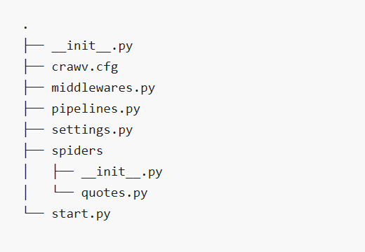

# Crawv

A powerful, high-performance asynchronous web crawling and scraping framework built on Python's asyncio ecosystem.

English | [中文](./doc/README_ZH.md)

## Overview

Crawv is a fast high-level web crawling and web scraping framework, used to crawl websites and extract structured data from their pages. It draws inspiration from Scrapy and scrapy_redis but is designed from the ground up to leverage the full power of asynchronous programming.

### Key Features

- **Fully Asynchronous**: Built on Python's asyncio for high-performance concurrent operations
- **Scrapy-like API**: Familiar API for those coming from Scrapy
- **Distributed Crawling**: Support for distributed crawling using Redis
- **Multiple HTTP Backends**: Support for aiohttp, httpx, and requests
- **Dynamic Variable Injection**: Powerful dependency injection system
- **Flexible Middleware System**: Customizable request/response processing pipeline
- **Robust Item Processing**: Pipeline for processing scraped items

## Requirements

- Python 3.8+
- Works on Linux, Windows, macOS, BSD

## Installation

### Basic Installation

```shell
pip install crawv
```

### With All Dependencies

```shell
pip install crawv[all]
```

### With Specific HTTP Backends

```shell
pip install crawv[aiohttp,httpx]
```

### Latest Version from GitHub

```shell
pip install git+https://github.com/seme555/crawv
```

## Quick Start

### Creating a New Project

```shell
crawv startproject myproject
cd myproject
```

### Creating a Spider

```shell
crawv genspider myspider
```

This will create a basic spider in the `spiders` directory.



### Example Spider

